# Architecture

Each arrow is a Cargo path dependency. Third-party crates enter only through the TLS adapter and the crypto crate, and only `crates/sys` contains `unsafe` code.

## First-party ownership

One repository contains a dependency-free core, first-party derive crate,
explicit TLS adapter, the cryptography crate (reviewed RustCrypto wrappers) and isolated development infrastructure. Rust `std` is
reused directly. Generic streams remain caller-owned.

The bootstrap has zero runtime, build, development, proc-macro, or target-specific Cargo dependencies. CI toolchains and Python/Go test drivers are development infrastructure, tracked separately from the application graph.

## API contracts

Public operations that parse untrusted input or perform I/O return `Result`. Parser errors include byte offsets where the module exposes that detail. Where Go panics on caller misuse, the Rust API returns an error. Behaviour follows Go by default; the differences are recorded in COMPATIBILITY.md and `docs/api`.

JSON traits use first-party `Value`; zero-dependency derives implement those
same traits. This trades allocations for an inspectable API. Incremental
hex/Base64/CSV/compression/multipart APIs coexist with bounded conveniences.
XML (`encoding::xml`) is Go's tokenizer, encoder and struct-tag marshaling: values describe themselves through `Marshal`/`Unmarshal` (derived from Go-style `#[xml("...")]` tags) and a run-time port of Go's `typeinfo.go` interprets the tags.

No production-source placeholders or `unsafe` blocks are permitted. Unsupported protocol variants are represented by explicit errors, and missing modules remain absent from the API.

## Runtime boundary

HTTP/1.1 parsing and framing consume `bufio` readers and write to `std::io::Write`; connections are `net::Conn` values, so TLS streams or in-memory pipes plug in without replacing the parsers. The server runs one thread per connection and the `Transport` pools connections per origin, as Go's does; handlers must cooperate with cancellation because arbitrary application code cannot be forcibly stopped.

## Compatibility policy

Versions are pre-1.0. Public changes require changelog and example/test updates.
The minimum Rust version is 1.87, the first with `std::io::pipe`, which `os::pipe` uses. The full local gate last ran on Rust 1.85 before that bump; VERIFICATION.md describes it. The public semver/MSRV promise requires passing release gates.

The Go coverage inventory is capability-oriented. Compiler/runtime packages, Go AST tooling, and exact Go naming/signatures are tracked separately. Functionality supplied by Rust `std` does not need first-party wrappers for branding.
