# Parity workflow

How to close Go API gaps. Read AGENTS.md first; its hard constraints are binding.

Each package's check script sends the same seeded requests to a Go oracle and a Rust probe and compares the outputs line by line. `tools/check.py` runs every such suite and also checks the symbol maps that build the scoreboard.



## Definition of done for a package

`python3 tools/api_parity.py` shows the package as `complete`: every symbol in
`docs/api/go-surface.json` for that package has a reviewed entry (no
`"auto": true`) in `docs/api/<package with / as _>.json`, and every entry is
backed by Go-equivalent behaviour.

```json
{"package": "strings",
 "notes": "one-line summary of the Rust mapping and any package-wide deviation",
 "symbols": {
   "Fields": {"rust": "str::split_whitespace"},
   "Builder.Grow": {"rust": "std::string::String::reserve"},
   "Reader.Len": {"rust": "std::io::Cursor::get_ref", "note": "optional detail"},
   "Title": {"deviation": "deprecated-unicode", "note": "why Rust cannot express it"}}}
```

- `rust` is any resolvable path: crate item (`rust_stdlib::…`), std item
  (`std::…`, `str::…`, `u8::…`), method, field or trait item. rustdoc proves it
  exists. Map to std when it provides the same capability and semantics (see
  below); otherwise implement a first-party item.
- `differs` marks a mapping whose behaviour is known to differ from Go in a way
  Rust could express (`{"rust": ..., "differs": "reason-code", "note": ...}`).
  A package is not complete while any entry has `differs`; fix the behaviour
  instead. Every behavioural difference you notice must be recorded as either
  `differs` or (if truly inexpressible) `deviation`, never only in prose notes.
- An entry may carry both `rust` and `deviation` when a Rust item covers the
  symbol but part of Go's behaviour is inexpressible; it counts as a deviation.
- `deviation` is only for things Rust cannot express: nil versus empty,
  panics, reflection (`any` arguments), unexported-embedding, goroutine or
  runtime internals. Use short kebab-case reason codes. Deprecated Go APIs are
  still implemented. "Not done yet" is never a deviation.
- Parity means Go's capabilities and semantics, built the Rust-native way.
  When Rust's std already provides a capability (sorting, float parsing and
  shortest formatting, UTF-8/UTF-16, case mapping, collections, iterators,
  I/O traits), use it and wrap only the Go-specific parts: syntax, error
  values, textual formats, API shape. Do not port Go's internal algorithms or
  tables to reproduce implementation-defined details: the order of equal
  elements after an unstable sort, the Unicode version, or the choice among
  equally valid outputs. Differentials must accept those differences, and the
  package notes list them. Generate data from Go only where std has no
  equivalent (e.g. Unicode general categories and scripts).
- Go's documented behaviour is the default. Resource limits are allowed only as
  configurable budgets whose defaults do not change results on Go's own tests.
- Dependencies: none, except reviewed cryptography crates for `crypto/*`
  (docs/adr/0003-vendored-cryptography.md).
- Rust naming: snake_case functions and methods, CamelCase types, SCREAMING
  constants. Errors are `Result`s; Go functions returning `(T, error)` return
  `Result<T, E>`. Go `io.Reader`/`io.Writer` become `std::io::Read`/`Write`.

## Required evidence per package

1. `tests/<module>.rs`: port the tables from `$(go env GOROOT)/src/<pkg>/*_test.go`.
   Generate fixtures with a Go program when the tables are large.
2. A Go differential: `tools/<name>_oracle.go`, `examples/<name>_probe.rs` and
   `tools/<name>_check.py`, registered in `tools/parity_check.py`. Feed thousands
   of generated and mutated inputs to both and compare exact outputs and
   errors. Keep each suite under about 20 seconds.
   Template: `tools/base32_check.py`, `tools/base32_oracle.go` and
   `examples/base32_probe.rs`.
3. `python3 tools/api_parity.py` regenerated (it writes `docs/coverage.json`,
   `docs/COVERAGE.md` and `src/api_surface.rs`).
4. A `CHANGELOG.md` entry under the unreleased version for user-visible changes.
5. If you port Go code or tables, add the file to `NOTICE` (Go is BSD-licensed).

## Before committing

Branch hygiene:

- Work on a topic branch off `main` and open a pull request. Bring in `main`
  with `git merge main`; never `reset`, `checkout <old commit> -- .`, or rebuild
  your branch from a saved tree.
- Before your final commit, `git diff main --stat --diff-filter=D` must
  list only files you created, and `git diff main --stat` only files
  you meant to change.
- Use your own subdirectory of any shared scratch directory for logs and
  scripts; never write to files you did not create there.

The machine runs many workers at once: `export CARGO_BUILD_JOBS=4`, iterate with
targeted tests, and run the full gate once at the end. Immediately before that
final gate, run `git merge main` and resolve any conflicts, so the gate runs
against current shared APIs.

```sh
cargo fmt
cargo clippy --all-targets --offline --locked -- -D warnings
cargo clippy --no-default-features --all-targets --offline --locked -- -D warnings
python3 tools/check.py   # every check passes; do not edit files while it runs
```

If offline resolution fails, run
`cargo fetch --locked --manifest-path backends/tls/Cargo.toml` and the same for
`fuzz/Cargo.toml`. Never commit `target/`, logs or reports. End commit messages
with the attribution lines you were given.

## Report

Branch, SHA, the package's api_parity line (mapped/deviations/missing/total),
differential vector counts, and every deviation with its reason.
